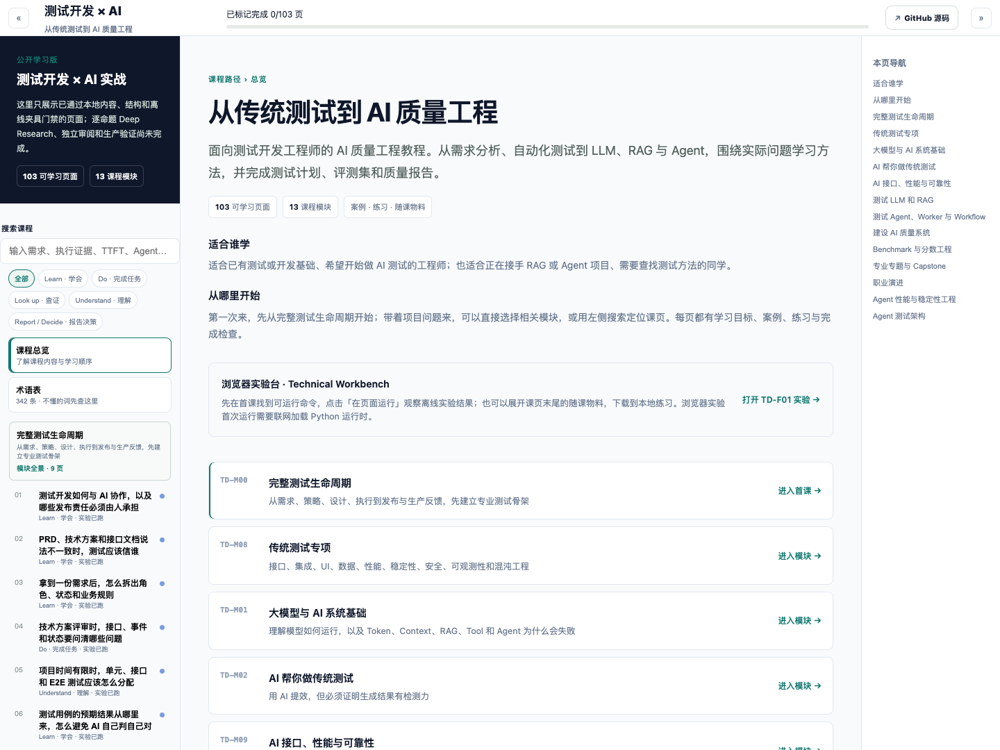
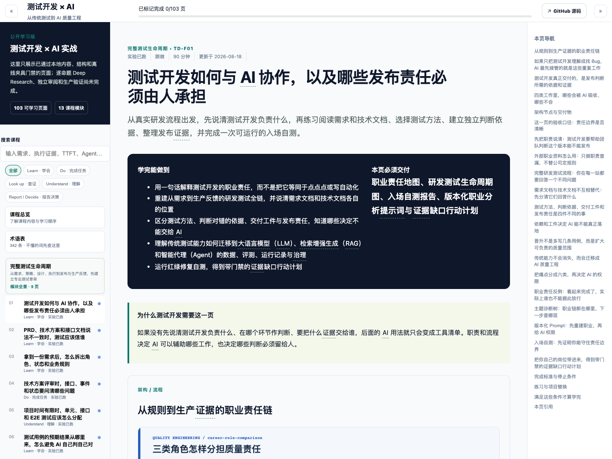
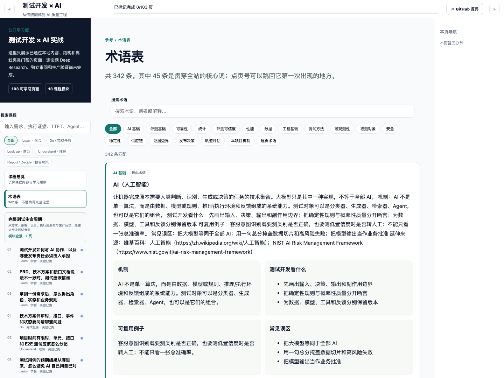

# 测试开发 × AI

面向测试开发工程师的 AI 质量工程教程。从需求分析、自动化测试到 LLM、RAG 与 Agent，围绕实际问题学习方法，并完成测试计划、评测集和质量报告。

**[在线阅读](https://wpowen.github.io/test-development-ai-course/#path)** · **[从第一课开始](https://wpowen.github.io/test-development-ai-course/#TD-F01)** · **[查阅术语表](https://wpowen.github.io/test-development-ai-course/#glossary)**

## 先看看课程

当前提供 **13 个模块、103 页课文**，配有逐页架构图、案例、练习和随课下载物料。点击下面的截图，可以直接打开对应页面。

### 课程总览：选择适合自己的起点

已有测试或开发基础、准备开始做 AI 测试，可以从完整测试生命周期读起；正在做 RAG 或 Agent 项目，可以按模块查找方法。

[](https://wpowen.github.io/test-development-ai-course/#path)

[打开课程总览 →](https://wpowen.github.io/test-development-ai-course/#path)

### 课页阅读：学方法，也留下能复用的产物

每页给出学习目标、案例与反例、练习和完成检查。架构图可以放大查看；遇到不熟悉的术语，可以直接打开解释。支持的 Python 命令可在浏览器中运行，随课物料也可以下载到本地练习。

[](https://wpowen.github.io/test-development-ai-course/#TD-F01)

[阅读第一课 →](https://wpowen.github.io/test-development-ai-course/#TD-F01) · [浏览随课物料](public/materials/)

### 术语查阅：从概念回到测试问题

术语表包含解释、工作机制、测试关注点、例子、常见误区和来源，并提供关联课页入口。

[](https://wpowen.github.io/test-development-ai-course/#glossary)

[打开术语表 →](https://wpowen.github.io/test-development-ai-course/#glossary)

## 能学到什么

模块按站点中的学习顺序排列；点击模块名称，可查看全景和课页目录。

| 模块 | 页数 | 学习内容 |
| --- | ---: | --- |
| [完整测试生命周期](https://wpowen.github.io/test-development-ai-course/#TD-M00) | 9 | 需求依据、风险、测试设计、自动化、执行与发布 |
| [传统测试专项](https://wpowen.github.io/test-development-ai-course/#TD-M08) | 13 | 接口、Web / 移动端、数据、安全、可靠性与可观测性 |
| [大模型与 AI 系统基础](https://wpowen.github.io/test-development-ai-course/#TD-M01) | 8 | 模型运行、Token、上下文、RAG、工具与 Agent |
| [AI 帮你做传统测试](https://wpowen.github.io/test-development-ai-course/#TD-M02) | 4 | 生成用例与代码、检查预期结果、验证缺陷检测力 |
| [AI 接口、性能与可靠性](https://wpowen.github.io/test-development-ai-course/#TD-M09) | 6 | 流式响应、结构化输出、延迟、吞吐、重试与降级 |
| [测试 LLM 和 RAG](https://wpowen.github.io/test-development-ai-course/#TD-M03) | 8 | 评测数据、检索质量、回答质量与自动评分 |
| [测试 Agent、Worker 与 Workflow](https://wpowen.github.io/test-development-ai-course/#TD-M04) | 10 | 执行轨迹、状态、权限、工具调用与多 Agent 协作 |
| [建设 AI 质量系统](https://wpowen.github.io/test-development-ai-course/#TD-M05) | 8 | CI 门禁、版本记录、线上回归与回滚决策 |
| [Benchmark 与分数工程](https://wpowen.github.io/test-development-ai-course/#TD-M06) | 6 | 数据集、评分方法、统计区间、污染与分数复现 |
| [专业专题与 Capstone](https://wpowen.github.io/test-development-ai-course/#TD-M07) | 5 | 需求系统、流水线、测试环境与综合质量报告 |
| [职业演进](https://wpowen.github.io/test-development-ai-course/#TD-M10) | 7 | 能力自评、岗位方向、90 天计划与作品集 |
| [Agent 性能与稳定性工程](https://wpowen.github.io/test-development-ai-course/#TD-M11) | 8 | 工作负载、Trace、容量、长稳、SLO 与故障处置 |
| [Agent 测试架构](https://wpowen.github.io/test-development-ai-course/#TD-M12) | 11 | 评估器、轨迹、交接、人工接管、安全与业务治理 |

## 怎么使用

1. **系统学习**：从[第一课](https://wpowen.github.io/test-development-ai-course/#TD-F01)开始，按前置页面与模块顺序推进。
2. **解决当前问题**：用站点左侧搜索查找需求、RAG、TTFT、Agent 等主题，或按“学会 / 完成任务 / 查证 / 理解 / 报告决策”筛选。
3. **动手练习**：在课页中运行支持的离线实验，或展开页末的随课物料，按包内 README 在本地操作。浏览器实验首次运行需要联网加载 Python 运行时。
4. **记录进度**：完成练习与检查项后标记课页。进度保存在当前浏览器，不会跨设备同步。

课程实验目前以离线夹具为基础，便于复现方法与失败案例。真实模型效果、企业集成、从业者评审和生产收益尚未完成验证；使用到具体项目时，需要结合自己的数据、环境和风险重新验证。

## 本地运行

需要 Node.js 22.13 或更高版本，以及 npm；建议使用 Node.js 24。

```bash
git clone https://github.com/wpowen/test-development-ai-course.git
cd test-development-ai-course
npm ci
npm run dev
```

打开终端显示的本地地址。也可以导出与在线学习站一致的静态版：

```bash
npm run export:static
python3 -m http.server 8080 --directory dist-github-pages
```

然后打开 [本地课程总览](http://localhost:8080/#path)。请通过 HTTP 服务预览，页面会按需加载课程数据。

## 开发与内容维护

- [SVG 图片维护](scripts/visuals/README.md)：126 个正式图形资源的正文绑定、生成与渲染检查；[全图重绘交付记录](docs/svg-redesign-2026-10-26/DELIVERY.md)。
- [维护说明](docs/MAINTAINING.md)：目录结构、公开仓库检查、完整工程验证与发布方式。
- [报告问题或提出改进](https://github.com/wpowen/test-development-ai-course/issues)：请附课页编号、问题描述，以及涉及实验时的复现步骤。

本仓库包含学习站、公开课程数据和随课物料。课程正文的源 JSON 与投影生成器位于独立的完整工程中；`content/modules/` 是生成结果，修改课程正文前请先阅读维护说明。
